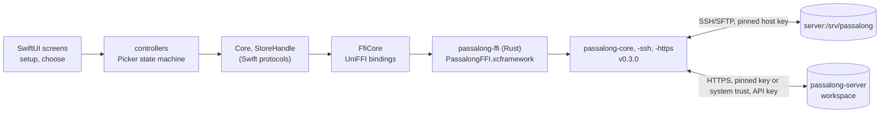

# passalong-ios

The iOS client for [passalong](https://github.com/joelee/passalong), a
lightweight, cross-platform clipboard and file sharing tool. One machine
you already own runs a plain SSH server with a storage directory, or a
[passalong-server](https://github.com/joelee/passalong-server) workspace;
every other device pushes and pulls items there. No cloud service, no
account.

**Status:** bootstrapping. The repository has the ways of working (agent
contracts, docs, quality gates); the app is planned in
[PLAN-00001](docs/plans/), which brings it to parity with
[passalong-android](https://github.com/joelee/passalong-android): the item
picker of `passalong choose` and the in-app setup that replaces
`passalong init`, for an SSH server or a passalong-server workspace.



The app reuses the Rust core through a UniFFI bridge, as the Android app
does, so host-key pinning, the item schema, SHA-256 verification,
deduplication, the list cache, and encrypted stores behave exactly like
the CLI.

See [docs/usage.md](docs/usage.md) for the screens,
[docs/configuration.md](docs/configuration.md) for where the app keeps
what, and [docs/architecture.md](docs/architecture.md) for how it is put
together.

## Development

Requires macOS with Xcode 16 or later, a Rust toolchain with the iOS
targets, [XcodeGen](https://github.com/yonaskolb/XcodeGen),
[SwiftLint](https://github.com/realm/SwiftLint), and
[`just`](https://github.com/casey/just). See
[docs/developer-guide.md](docs/developer-guide.md) for one-time setup.

```sh
just setup        # once: brew bundle, rustup targets
just check        # fmt-check, lint, test, coverage, build
just run          # the debug app in the iPhone Simulator
```

## License

Licensed under the [Apache License, Version 2.0](LICENSE). See
[NOTICE](NOTICE) for third-party material.
