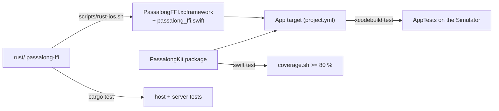

# Delivery Plan 00001: iOS Client Parity With Android

> [!abstract] Plan status: `draft`
> Build the iOS app from an empty repository to feature parity with
> passalong-android v0.2.0 (setup for an SSH server or a passalong-server,
> and the choose screen) over the same Rust core through a UniFFI bridge.
> All decisions are resolved; Builder-ready once the user approves.

## 1. Objective and outcome

An iPhone app, built from this repository on a Mac with `just check`
green, that does what passalong-android does today: set the device up
against an SSH server (device key, host-key fingerprint confirmed before
pinning) or a passalong-server workspace (certificate pin or system
trust, API key, server inspection, the "not encrypted" confirmation),
then list, filter, load, show, inspect, and delete stored items, with the
same status messages, config format, and on-disk layout. Store logic
stays in the Rust core so the app behaves exactly like the CLI.

## 2. Source traceability

| Requirement | Source | Source location | Interpretation |
|---|---|---|---|
| PLAN-00001-REQ-01 | User; Repository | User instruction 2026-10-04 ("fully replicate the features of ../passalong-android"); `../passalong-android/rust/` (`passalong-ffi` 0.2.0) | The same bridge exports, built for iOS |
| PLAN-00001-REQ-02 | Repository | `AGENTS.md` § Stack, § Commands; `justfile`; `.github/workflows/ci.yml` | Every `just` recipe works on macOS; CI runs them |
| PLAN-00001-REQ-03 | User; Repository | `../passalong-android/docs/usage.md` § Setup; `SetupController.kt` | Setup flow parity, both server kinds |
| PLAN-00001-REQ-04 | User; Repository | `../passalong-android/docs/usage.md` § Choose; `ChooseController.kt`, `domain/Picker.kt` | Choose screen parity |
| PLAN-00001-REQ-05 | Repository | `docs/configuration.md`; `../passalong-android/docs/configuration.md` | Files, paths, and secrets handling |
| PLAN-00001-REQ-06 | Repository | `AGENTS.md` § Observability | Core logs reach the unified log; no secrets logged |
| PLAN-00001-REQ-07 | Repository | `AGENTS.md` § Non-negotiables | TDD, Swift Testing with fakes, coverage >= 80 % over PassalongKit |
| PLAN-00001-REQ-08 | Repository | `AGENTS.md` § Non-negotiables; `../passalong-android/rust/tests/server.rs`, `app/src/androidTest/` | Host, server, and Simulator integration tests |
| PLAN-00001-REQ-09 | Repository | `AGENTS.md` § Docs to maintain, § New feature workflow | Docs, CHANGELOG, backlog current |

## 3. Repository baseline

| Field | Value |
|---|---|
| Repository | joelee/passalong-ios (local; no remote yet) |
| Branch | main |
| HEAD | 62380f4dde1297e22379b3b89aa57a6ce5e1f100 |
| Working tree at publication | Clean (only this allocated plan file untracked) |
| Applicable instructions | `AGENTS.md`; `docs/plans/AGENTS.md` |

Reference implementation: `../passalong-android` at `9c2bf59` (PLAN-00002
complete). Core: `passalong-core`, `passalong-ssh`, `passalong-https`
0.3.0, now published on crates.io (`cargo search`, 2026-10-04).

## 4. Scope

### In scope

- `rust/`: `passalong-ffi` for iOS, every export Android's bridge has.
- `scripts/rust-ios.sh`, `scripts/coverage.sh`, `scripts/sim-run.sh`;
  `project.yml`; `PassalongKit/`; `App/`; `AppTests/`.
- Setup (SSH and passalong-server) and Choose, as in passalong-android's
  `docs/usage.md`, with the iOS differences in `docs/architecture.md`.
- Unit, host, server, and Simulator integration tests; CI on macOS.
- Docs, CHANGELOG, backlog.

### Out of scope

- Features Android does not have yet: joining an encrypted store,
  sending, a Share extension, QR import, a `check` screen.
- XCUITest UI tests of the SwiftUI views (backlog, as on Android).
- Signing, TestFlight, App Store, icon and branding, iPad layouts.
- Moving the bridge to a shared crate (backlog, Housekeeping).

## 5. Constraints and preserved decisions

- SwiftUI, iOS 17+, Swift 6 language mode (user, 2026-10-04).
- Builds and Simulator runs happen on the user's Mac; Linux can run only
  the Rust recipes (user, 2026-10-04).
- The Xcode project is generated by XcodeGen and never committed.
- The app never reimplements store logic; only `App/Core/FfiCore.swift`
  imports the bindings.
- Never copy code from passalong-server (AGPL-3.0); the server tests use
  its documented CLI only, as Android's `rust/tests/support/mod.rs` does.
- Status messages, prompts, and config output match passalong-android's
  word for word, except where an iOS difference is recorded.
- Bundle identifier `io.github.joelee.passalong`, as Android's
  `applicationId`; version 0.1.0 (build 1).

## 6. Assumptions

None. Unresolved matters are recorded as decisions and block approval when
material.

## 7. Decisions and blockers

| ID | Decision or blocker | Resolution | Owner | Status |
|---|---|---|---|---|
| D-01 | Where the bridge source lives | Copy `../passalong-android/rust/` at `9c2bf59` into `rust/`, record that commit in `rust/Cargo.toml`, and adapt it: iOS code only in `cfg(target_vendor = "apple")` branches beside Android's, file and module names kept, doc wording platform-neutral. A separate copy is what lets the crate `forbid(unsafe_code)`; a shared crate could only `deny` it, because Android's logcat and JNI calls need `unsafe`. A shared crate stays on the backlog, triggered by Android's next change to `rust/` (STEP-09). Rejected: a shared crate now (needs its own Android plan on an unmerged branch; out of scope in §4) | User (2026-10-24) | resolved |
| D-02 | Where a loaded file goes | The app's `Documents/`, shown in Files as *On My iPhone › Passalong* (`UIFileSharingEnabled`, `LSSupportsOpeningDocumentsInPlace`, `CFBundleDisplayName` `Passalong`). The core downloads and verifies into `Application Support/Downloads/`; `FilesSink` moves the file into `Documents/` under a free name in the core's `name (n).ext` form, never replacing a file; the staged copy is removed in `finally`, as on Android. One tap, no dialog. Success shows once as a banner (Android's snackbar): `<name> saved to Files`; sink failures read `cannot create <name> in Files` / `cannot write <name> in Files` inside the usual `cannot load <id>: …` status. Rejected: a share sheet or `fileExporter` on every load; picking a save folder once (backlog) | User (2026-10-24) | resolved |
| D-03 | Source of the core crates | `=0.3.0` from crates.io (published since Android pinned a git rev; the core crates are identical between Android's rev `9ed0d4d` and the `v0.3.0` tag `ec99f50`) | Planner | resolved |
| D-04 | Logging on iOS | `oslog` 0.2.0 (safe wrapper, MIT, `default-features = false`) under `cfg(target_vendor = "apple")`, so the crate can `forbid(unsafe_code)` | Planner | resolved |
| D-05 | Simulator slices | `aarch64-apple-ios-sim` only (Apple Silicon); x86_64 on the backlog | Planner | resolved |
| D-06 | Swift formatter and linter | `swift format` from the toolchain; SwiftLint | Planner | resolved |

## 8. Affected architecture and components

All paths are new. Layers and the Android-to-iOS mapping are in
`docs/architecture.md`.

| Android | iOS |
|---|---|
| `rust/` `passalong-ffi` (cdylib, JNA) | `rust/` `passalong-ffi` (staticlib → `rust/generated/PassalongFFI.xcframework`, Swift bindings in `rust/generated/swift/`) |
| `rust/src/android_tls.rs`, `NativeTls.kt` | removed: the platform verifier needs no initialisation on iOS |
| `rust/src/logging.rs` (logcat) | `rust/src/logging.rs` (unified log) |
| `domain/`, `core/`, `data/`, `choose/`, `setup/` | `PassalongKit/Sources/PassalongKit/{Domain,Core,Data,Choose,Setup}/` |
| `app/src/test/kotlin/...` | `PassalongKit/Tests/PassalongKitTests/...` |
| `android/FfiCore.kt`, `Sinks.kt`, `AppContainer.kt` | `App/Core/FfiCore.swift`, `App/Platform/Sinks.swift`, `App/AppContainer.swift` |
| `ui/Root.kt`, `ui/setup/`, `ui/choose/` | `App/UI/RootView.swift`, `App/UI/Setup/`, `App/UI/Choose/` |
| `app/src/androidTest/` (`NativeTlsTest`, `ServerFlowTest`) | `AppTests/` (`NativeTlsTests`, `ServerFlowTests`) |
| `scripts/rust-android.sh`, Gradle `preBuild` | `scripts/rust-ios.sh`, Xcode pre-build script in `project.yml` |
| Kover | `scripts/coverage.sh` (`swift test --enable-code-coverage` + `llvm-cov report`) |

## 9. Requirement catalogue

### PLAN-00001-REQ-01 — The bridge on iOS

- **Requirement:** `rust/` builds `passalong-ffi` for `aarch64-apple-ios`
  and `aarch64-apple-ios-sim` with every UniFFI export of Android's bridge
  (`core_version`, `bridge_version`, `init_logging`, `fetch_host_key`,
  `probe_server`, `parse_tls_pin`, `parse_api_key`, `has_api_key`,
  `save_api_key`, `render_config`, `render_https_config`,
  `validate_config`, `generate_identity`, `inspect_server`,
  `device_has_store_key`, `open_store` and the store methods), on
  `passalong-core`, `-ssh`, `-https` `=0.3.0` from crates.io, with no
  `unsafe` code.
- **Rationale:** parity with Android and the CLI through one core.
- **Source:** User; `../passalong-android/rust/src/`.
- **Acceptance evidence:** AC-01, AC-02.

### PLAN-00001-REQ-02 — Build pipeline and gates

- **Requirement:** `just setup`, `gen`, `fmt`, `fmt-check`, `lint`,
  `test`, `coverage`, `rust`, `build`, `run`, `test-ios`, `test-https`,
  `check`, and `clean` work on macOS as `docs/developer-guide.md`
  describes; CI runs `just check` and `just test-https` on `macos-15`.
- **Rationale:** `AGENTS.md` § Commands.
- **Source:** `AGENTS.md`; `justfile`.
- **Acceptance evidence:** AC-03, AC-13.

### PLAN-00001-REQ-03 — Setup parity

- **Requirement:** the setup screen asks the server kind first and runs
  Android's SSH flow (generated ed25519 key shown for `authorized_keys`,
  *Replace*, server fields with the same defaults, host-key fingerprint
  confirmed before pinning, no trust on first use) and passalong-server
  flow (`http://` refused, certificate probed without a request, pin
  pasted or *Trust the system*, three wrong pins stop, API key in a secure
  field checked for shape, saved key reused, server inspection line, "not
  encrypted" confirmation unless a store key is held); nothing is written
  until confirmed.
- **Rationale:** feature parity.
- **Source:** `../passalong-android/docs/usage.md` § Setup;
  `SetupController.kt`.
- **Acceptance evidence:** AC-05, AC-06, AC-11.

### PLAN-00001-REQ-04 — Choose parity

- **Requirement:** the choose screen lists items newest first (from a
  fresh list cache with `cached N s ago`, or the server), filters by id,
  name or preview, device, or kind, loads on tap (text to the
  pasteboard; files and clipboard images verified and saved per D-02),
  offers *Load*, *Show content*, *Details*, *Delete* (confirmed) on long
  press, reloads from cache or server, shows help, offers *Set up again*,
  names the store in the bottom line, warns of an API key expiring within
  14 days, and offers setup first when the server refuses the key for
  good; the transient and failure statuses match Android's.
- **Rationale:** feature parity.
- **Source:** `../passalong-android/docs/usage.md` § Choose;
  `ChooseController.kt`; `domain/Picker.kt`.
- **Acceptance evidence:** AC-05, AC-07, AC-11.

### PLAN-00001-REQ-05 — Files and secrets

- **Requirement:** config, keys, `api.key`, list cache, and download
  staging live in Application Support as `docs/configuration.md` lists,
  excluded from backup, with file protection; the core sees that
  directory as `HOME` through the bridge's `AppEnv`; the API key is never
  in the config, logs, or cache.
- **Rationale:** same layout and guarantees as Android.
- **Source:** `docs/configuration.md`; `AGENTS.md` § Config and secrets.
- **Acceptance evidence:** AC-08.

### PLAN-00001-REQ-06 — Logging

- **Requirement:** `init_logging` sends core records to the unified log
  (subsystem `io.github.joelee.passalong`, category `passalong`) at
  `debug` in Debug builds and `info` otherwise; pasteboard text, file
  contents, keys, and secrets are never logged.
- **Rationale:** `AGENTS.md` § Observability.
- **Source:** `AGENTS.md`.
- **Acceptance evidence:** AC-09.

### PLAN-00001-REQ-07 — Unit tests and coverage

- **Requirement:** every PassalongKit type is built test-first with Swift
  Testing and fakes ported from Android's `support/Fakes.kt`; Android's
  domain, data, setup, and choose test cases all have Swift counterparts;
  line coverage over PassalongKit is >= 80 %.
- **Rationale:** `AGENTS.md` § Non-negotiables.
- **Source:** `AGENTS.md`; `../passalong-android/app/src/test/`.
- **Acceptance evidence:** AC-04.

### PLAN-00001-REQ-08 — Integration tests

- **Requirement:** the bridge's host tests and its server tests
  (`rust/tests/server.rs`, ignored without `PASSALONG_SERVER_BIN`) pass;
  Simulator tests prove TLS through the system trust store and, given a
  test server, the whole setup-then-choose flow over the real bridge.
- **Rationale:** `AGENTS.md`: integration coverage planned up front.
- **Source:** `../passalong-android/rust/tests/server.rs`,
  `app/src/androidTest/`.
- **Acceptance evidence:** AC-02, AC-10, AC-11.

### PLAN-00001-REQ-09 — Docs

- **Requirement:** `README.md`, `docs/architecture.md`,
  `docs/configuration.md`, `docs/usage.md`, `docs/developer-guide.md`,
  `docs/backlog.md`, and `CHANGELOG.md` describe what was built, with the
  "Planned" notes removed.
- **Rationale:** `AGENTS.md` § Docs to maintain.
- **Source:** `AGENTS.md`.
- **Acceptance evidence:** AC-14.

## 10. Delivery strategy

Bottom-up, each step leaving `main`'s gates no worse. The bridge comes
first because it can be built and tested on Linux and fixes the API every
Swift layer depends on. The build pipeline follows, proving the
XCFramework links into a Simulator app before any logic is written. The
platform-free layers (domain, data, controllers) are ported next,
test-first, from Android's Kotlin and its tests, so behaviour is pinned
by the same cases. The app layer (FfiCore, sinks, views) then wires the
real bridge in, and Simulator tests close the loop against a real
passalong-server. Docs and CI finish.

Porting rule: for each Kotlin file, port its test file to Swift Testing
first, see it fail to compile or fail, then port the production code
idiomatically (`struct`/`enum` with associated values for sealed
interfaces, `async throws` for `suspend`, `@Observable @MainActor` final
classes for the `StateFlow` controllers, injected executors for
`Dispatchers.IO`). Keep names and status strings.

Steps 01 and 03–06 are verifiable without a Simulator; 02, 07, and 08
need the Mac.

## 11. Detailed implementation steps

### PLAN-00001-STEP-01 — The bridge crate for iOS

- **Objective:** `rust/` holds `passalong-ffi` 0.1.0 for iOS, tested on
  the host.
- **Requirements:** `PLAN-00001-REQ-01`, `PLAN-00001-REQ-06`,
  `PLAN-00001-REQ-08`
- **Depends on:** None (D-01: copy).
- **Affected components:** `rust/Cargo.toml`, `rust/Cargo.lock`,
  `rust/uniffi.toml`, `rust/src/*.rs`, `rust/tests/`,
  `scripts/bridge-drift.sh`.
- **Preconditions:** clean tree on `feature/00001-ios-parity`.
- **Test or evidence first:** copy Android's `rust/tests/` and the unit
  tests inside `rust/src/`; add a test that `init_logging` accepts every
  level once on a non-Apple host; run `cargo test` and see it fail until
  the crate builds.
- **Implementation tasks:**
  1. Copy `../passalong-android/rust/{Cargo.toml,Cargo.lock,src,tests,uniffi.toml}`
     at `9c2bf59` (per D-01); set `repository`, `description`,
     `version = "0.1.0"`, and a comment `ported from passalong-android
     rust/ @ 9c2bf59`. Keep file and module names.
  2. Replace the three git dependencies with `version = "=0.3.0"`.
  3. Delete `android_tls.rs` and its `mod`; drop the Android target
     dependencies.
  4. `crate-type = ["staticlib", "cdylib", "lib"]` (static for iOS,
     cdylib for the host bindgen); `unsafe_code = "forbid"`.
  5. In `logging.rs`, replace the logcat `emit` with an `oslog::OsLog`
     writer under `cfg(target_vendor = "apple")` (`oslog` with
     `default-features = false`), mapping the syslog-like priorities to
     `OsLogLevel`; standard error under `cfg(not(target_vendor =
     "apple"))`.
  6. `uniffi.toml`: `[bindings.swift] module_name = "PassalongFFI"`,
     `ffi_module_name = "passalong_ffiFFI"` (both keys exist in
     uniffi_bindgen 0.29.5).
  7. Starting from Android's `Cargo.lock`, `cargo update -p
     passalong-core -p passalong-ssh -p passalong-https` only, so the
     transitive versions stay Android's; commit it.
  8. Reword Kotlin- or Android-specific rustdoc (e.g. `lib.rs` "Kotlin
     `suspend`") in platform-neutral terms, since it reaches the Swift
     bindings.
  9. `scripts/bridge-drift.sh`: diff `rust/src` and the exported symbol
     list against `../passalong-android/rust/` at the recorded commit
     (exports must equal Android's minus the JNI entry point), and
     compare the two lockfiles' versions; rerun at every Android port.
- **Documentation/configuration/operations:** none yet (STEP-09).
- **Verification:** `cargo fmt --check`, `cargo clippy --all-targets
  --all-features -- -D warnings`, `cargo test --all-features` on Linux or
  macOS; `PASSALONG_SERVER_BIN=… just test-https`;
  `cargo check --target aarch64-apple-ios` on macOS.
- **Completion criteria:** all pass; `scripts/bridge-drift.sh` shows the
  export list equals Android's minus the JNI entry point.
- **Rollback or recovery:** revert the step's commit.
- **Builder stop conditions:** 0.3.0 from crates.io changes behaviour
  Android's tests pin (the git rev differed): record the failing tests
  and stop.

### PLAN-00001-STEP-02 — XCFramework, Xcode project, and app shell

- **Objective:** a Simulator app that links the bridge and shows
  `core_version()`.
- **Requirements:** `PLAN-00001-REQ-02`
- **Depends on:** STEP-01.
- **Affected components:** `scripts/rust-ios.sh`, `scripts/sim-run.sh`,
  `project.yml`, `App/PassalongApp.swift`, `App/Info.plist` keys in
  `project.yml`, `AppTests/BridgeSmokeTests.swift`.
- **Preconditions:** macOS, Xcode 16+, `just setup` done.
- **Test or evidence first:** `AppTests/BridgeSmokeTests.swift` expecting
  `coreVersion() == "0.3.0"`; `just test-ios` fails until linked.
- **Implementation tasks:**
  1. `scripts/rust-ios.sh`: host `cargo build --locked`; `uniffi-bindgen
     generate --language swift` into `rust/generated/swift/`;
     `cargo build --locked --release --target` for both iOS targets;
     arrange headers and `module.modulemap`; `xcodebuild
     -create-xcframework` into `rust/generated/PassalongFFI.xcframework`.
     Skip the rebuild when inputs are unchanged (Xcode runs it each
     build).
  2. `project.yml`: app target `Passalong` (iOS 17.0, Swift 6, bundle id
     `io.github.joelee.passalong`, `MARKETING_VERSION` 0.1.0,
     `CURRENT_PROJECT_VERSION` 1), pre-build script running
     `rust-ios.sh` with input and output files listed, the XCFramework and
     `rust/generated/swift/passalong_ffi.swift` as sources, the local
     `PassalongKit` package, optional `Local.xcconfig`; test target
     `AppTests` hosted by the app; a shared scheme passing the
     `PASSALONG_TEST_*` environment variables.
  3. Minimal `PassalongKit/Package.swift` (swift-tools 6.0, iOS 17,
     macOS 14) with an empty library and test target, so `swift test`
     runs.
  4. `scripts/sim-run.sh`: boot the named Simulator, build, `simctl
     install`, `simctl launch`.
  5. `scripts/coverage.sh <threshold>`: `swift test
     --enable-code-coverage`, `llvm-cov report` over
     `PassalongKit/Sources`, print the line figure, exit non-zero below
     the threshold.
- **Documentation/configuration/operations:** none yet.
- **Verification:** `just build`, `just test-ios`, `just run` shows the
  version; `just check` passes (coverage trivially, empty package).
- **Completion criteria:** all recipes in REQ-02 succeed on the Mac.
- **Rollback or recovery:** revert the step's commit.
- **Builder stop conditions:** a static link failure that needs `unsafe`
  or a non-Apache/MIT dependency.

### PLAN-00001-STEP-03 — Domain

- **Objective:** `Item`, `Picker`, `Formats`, `Failures` in PassalongKit.
- **Requirements:** `PLAN-00001-REQ-04`, `PLAN-00001-REQ-07`
- **Depends on:** STEP-02.
- **Affected components:** `PassalongKit/Sources/PassalongKit/Domain/`,
  `PassalongKit/Tests/PassalongKitTests/Domain/`.
- **Preconditions:** STEP-02 green.
- **Test or evidence first:** port `ItemTest`, `FormatsTest`,
  `PickerTest` to Swift Testing; see them fail.
- **Implementation tasks:**
  1. Port `domain/Item.kt`, `Formats.kt`, `Failures.kt`, `Picker.kt`
     (value types; `Mode`, `PickerEvent`, `Outcome` as enums with
     associated values). Inject the time zone and clock as Android does.
- **Documentation/configuration/operations:** none.
- **Verification:** `just test`, `just coverage`.
- **Completion criteria:** every ported case passes; coverage >= 80 %.
- **Rollback or recovery:** revert.
- **Builder stop conditions:** a Kotlin behaviour that cannot be
  expressed without changing a status string.

### PLAN-00001-STEP-04 — Core protocols, data, and fakes

- **Objective:** `Core`, `ServerSetup`, `StoreHandle`, `CoreError`, the
  value types, `AppFiles`, `ItemActions`, the `PasteboardSink` and
  `FilesSink` protocols, and the test fakes.
- **Requirements:** `PLAN-00001-REQ-05`, `PLAN-00001-REQ-07`
- **Depends on:** STEP-03.
- **Affected components:** `PassalongKit/Sources/PassalongKit/{Core,Data}/`,
  `PassalongKit/Tests/PassalongKitTests/{Data,Support}/`.
- **Preconditions:** STEP-03 green.
- **Test or evidence first:** port `AppFilesTest`, `ItemActionsTest`, and
  `support/Fakes.kt`; see them fail.
- **Implementation tasks:**
  1. Port `core/Core.kt` (protocols `Sendable`; `async throws`).
  2. Port `AppFiles` over a home `URL`; writes are atomic and set file
     protection and the backup exclusion through an injectable hook.
  3. Port `ItemActions` (stage, publish, delete the staged copy in
     `defer`, as Android's `finally`).
  4. `FilesSink` protocol plus a `DocumentsFilesSink` in PassalongKit
     (D-02): moves the staged file into a documents directory under a
     free name (`report.pdf`, `report (1).pdf`, … in the core's form),
     never replacing a file, and returns the name used. Tested against a
     temporary folder with its own never-replace and numbering cases
     (Android's `ItemActionsTest` numbering only exercises its fake).
     Loads cannot race because the controller's busy gate serialises
     them; note that in its DocC.
- **Documentation/configuration/operations:** none.
- **Verification:** `just test`, `just coverage`.
- **Completion criteria:** ported cases pass; coverage >= 80 %.
- **Rollback or recovery:** revert.
- **Builder stop conditions:** none beyond the plan's.

### PLAN-00001-STEP-05 — Setup controller

- **Objective:** `SetupController`, Android's state machine for both
  server kinds.
- **Requirements:** `PLAN-00001-REQ-03`, `PLAN-00001-REQ-07`
- **Depends on:** STEP-04.
- **Affected components:** `PassalongKit/Sources/PassalongKit/Setup/`,
  tests.
- **Preconditions:** STEP-04 green.
- **Test or evidence first:** port all `SetupControllerTest` cases.
- **Implementation tasks:**
  1. Port `setup/SetupController.kt` as an `@Observable @MainActor` class
     with an injected background executor; same states, prompts, and
     three-wrong-pins rule.
- **Documentation/configuration/operations:** none.
- **Verification:** `just test`, `just coverage`.
- **Completion criteria:** all ported cases pass; coverage >= 80 %.
- **Rollback or recovery:** revert.
- **Builder stop conditions:** a Swift 6 isolation error that needs
  `@unchecked Sendable` without a soundness argument.

### PLAN-00001-STEP-06 — Choose controller

- **Objective:** `ChooseController` over `Picker`, `ItemActions`, and
  `StoreHandle`.
- **Requirements:** `PLAN-00001-REQ-04`, `PLAN-00001-REQ-07`
- **Depends on:** STEP-05.
- **Affected components:** `PassalongKit/Sources/PassalongKit/Choose/`,
  tests.
- **Preconditions:** STEP-05 green.
- **Test or evidence first:** port all `ChooseControllerTest` cases,
  recording the status at each fake-store call as Android's tests do.
- **Implementation tasks:**
  1. Port `choose/ChooseController.kt`; `connect()` called after
     construction; API-key expiry warning; permanent refusal offers
     setup first.
- **Documentation/configuration/operations:** none.
- **Verification:** `just test`, `just coverage`.
- **Completion criteria:** all ported cases pass; coverage >= 80 %.
- **Rollback or recovery:** revert.
- **Builder stop conditions:** as STEP-05.

### PLAN-00001-STEP-07 — The app: FfiCore, sinks, container, views

- **Objective:** the usable app on the Simulator and a phone.
- **Requirements:** `PLAN-00001-REQ-03`, `PLAN-00001-REQ-04`,
  `PLAN-00001-REQ-05`, `PLAN-00001-REQ-06`
- **Depends on:** STEP-06.
- **Affected components:** `App/Core/FfiCore.swift`,
  `App/Platform/Sinks.swift`, `App/Platform/DeviceName.swift`,
  `App/AppContainer.swift`, `App/UI/RootView.swift`,
  `App/UI/Setup/SetupView.swift`, `App/UI/Choose/ChooseView.swift`,
  `project.yml` (Info.plist keys per D-02).
- **Preconditions:** STEP-06 green.
- **Test or evidence first:** `AppTests/AppContainerTests.swift` (the
  container picks setup without a config and choose with one, as
  `AppContainerTest`); see it fail.
- **Implementation tasks:**
  1. `FfiCore`: implement `Core` over the bindings, mapping
     `PassalongError` to `CoreError`; the only bindings importer.
  2. Sinks: `UIPasteboard` text; `DocumentsFilesSink` over the app's
     `Documents/` URL (no logic in `App/` beyond the paths).
  3. `AppContainer`: Application Support as `HOME`, backup exclusion set
     on the Application Support directory itself, never on staged files
     (a per-file flag would travel with a moved file into Documents),
     `init_logging` (`debug`/`info` by build configuration), device name
     from the model identifier.
  4. SwiftUI: `RootView` switching setup/choose; `SetupView` (server-kind
     picker, forms, `SecureField` for the API key, confirmation dialogs);
     `ChooseView` (`List`, `.searchable`, `.refreshable`, `contextMenu`,
     toolbar `Menu` with *Read from the server*, *Help*, *Set up again*;
     content and details sheets; delete confirmation; bottom status bar;
     the controller's one-time message as a short banner over the list,
     as Android's snackbar).
     Accessibility labels on icon-only buttons; Dynamic Type respected.
- **Documentation/configuration/operations:** Info.plist keys in
  `project.yml`: `UIFileSharingEnabled`, `LSSupportsOpeningDocumentsInPlace`
  (both `YES`), `CFBundleDisplayName` `Passalong`.
- **Verification:** `just check`; manual run on the Simulator against a
  local passalong-server, every row of `docs/usage.md` § Choose
  exercised.
- **Completion criteria:** AC-05 to AC-09 observed.
- **Rollback or recovery:** revert.
- **Builder stop conditions:** an iOS restriction that forces a
  user-visible difference not listed in `docs/architecture.md`.

### PLAN-00001-STEP-08 — Simulator integration tests

- **Objective:** Android's instrumented tests on the Simulator.
- **Requirements:** `PLAN-00001-REQ-08`
- **Depends on:** STEP-07.
- **Affected components:** `AppTests/NativeTlsTests.swift`,
  `AppTests/ServerFlowTests.swift`.
- **Preconditions:** a local passalong-server per
  `docs/developer-guide.md`, seeded by the passalong CLI 0.3.0.
- **Test or evidence first:** the tests themselves; they skip without
  `PASSALONG_TEST_*`.
- **Implementation tasks:**
  1. `NativeTlsTests`: a publicly trusted host probes as trusted; the
     self-signed test server probes as untrusted with the expected pin.
  2. `ServerFlowTests`: setup controller over the real `FfiCore` against
     the server, then choose lists, reads, loads, and deletes the seeded
     item.
- **Documentation/configuration/operations:** developer guide section.
- **Verification:** `just test-ios https://127.0.0.1:8443 <pin> <key>
  <text>`.
- **Completion criteria:** both pass; skip cleanly without arguments.
- **Rollback or recovery:** revert.
- **Builder stop conditions:** the Simulator cannot reach the host
  server.

### PLAN-00001-STEP-09 — CI, docs, release notes

- **Objective:** documentation and CI match the built app.
- **Requirements:** `PLAN-00001-REQ-02`, `PLAN-00001-REQ-09`
- **Depends on:** STEP-08.
- **Affected components:** `README.md`, `docs/*.md`, `CHANGELOG.md`,
  `.github/workflows/ci.yml`, `NOTICE` (add `oslog`'s license if
  required).
- **Preconditions:** STEP-08 green.
- **Test or evidence first:** not applicable (docs); CI is its own test.
- **Implementation tasks:**
  1. Remove the "Planned" notes; describe what exists; record D-01 and
     D-02 outcomes.
  2. CHANGELOG `Unreleased`: the app, with PLAN-00001 references.
  3. Backlog: remove the parity milestone and the D-01/D-02 wait; add
     follow-ups found, and these from D-01 and D-02:
     - *One bridge crate for both apps*: when Android next changes
       `rust/` or both apps build on `main`, plan the extraction in both
       repos (a new `passalong-ffi` repo, thin wrapper crates, one
       `uniffi.toml` with Kotlin and Swift sections, macOS CI for the
       Apple branch); `forbid(unsafe_code)` becomes `deny` then, so
       REQ-01/AC-01 are restated. Until then every Android port starts
       with `scripts/bridge-drift.sh`.
     - *Save folder*: pick a folder once (security-scoped bookmark), e.g.
       iCloud Drive › Downloads, so saved files outlive the app.
     - *Share or preview a loaded file* from the banner or long-press
       menu (iOS extra; offer to Android).
     - *Clipboard images to the pasteboard*, after Android's backlog item.
     - *Check the free-name rule* against passalong-core's
       `download_into` for names with no or several extensions.
  4. `docs/architecture.md` § Differences from Android: core from
     crates.io, not git; "the same source", not "the same crate"; Android's
     JNI call is `init_with_env`; Documents numbered by `FilesSink`; saved
     files are deleted with the app and are backed up (Application
     Support is not); `saved to Files` for `saved to Downloads`; banner
     for snackbar. `docs/usage.md`: "under a numbered name if theirs is
     taken"; "clipboard", not "pasteboard"; help line "files to the Files
     app (On My iPhone › Passalong)".
  5. Adjust CI if the Xcode or Simulator name differs on `macos-15`.
- **Documentation/configuration/operations:** as above.
- **Verification:** `just check`; CI green after the user pushes.
- **Completion criteria:** AC-13, AC-14.
- **Rollback or recovery:** revert.
- **Builder stop conditions:** none.

## 12. Cross-cutting concerns

| Area | Applicability | Planned action or reason not applicable | Step or requirement |
|---|---|---|---|
| Compatibility and APIs | Applicable | Same config format and list-cache identity as the CLI and Android | REQ-05, STEP-01 |
| Data and migration | Not applicable | New app, no prior data | — |
| Security and privacy | Applicable | No TOFU; pins and host keys confirmed; API key in `SecureField`, file-protected, never logged; backup excluded | REQ-03, REQ-05, REQ-06 |
| Performance and scale | Applicable | Store calls async on tokio; file I/O off the main actor; release-profile Rust | STEP-01, STEP-07 |
| Reliability and failure handling | Applicable | Android's failure statuses ported with their tests; cancellations rethrown | STEP-05, STEP-06 |
| Observability and operations | Applicable | Unified log, levels by build | REQ-06 |
| Dependencies and supply chain | Applicable | Core pinned `=0.3.0`; `oslog` MIT; `Cargo.lock` committed; no AGPL code | STEP-01 |
| Accessibility and UX | Applicable | System controls, Dynamic Type, labels on icon buttons, iOS conventions | STEP-07 |
| Documentation and release | Applicable | Docs and CHANGELOG; no release in this plan | STEP-09 |
| Deployment and rollback | Not applicable | No distribution in scope; each step is one revertible commit | — |

## 13. Verification strategy

| Level | Evidence or command | When | Required result |
|---|---|---|---|
| Rust unit and host | `cargo test --all-features` (in `just test`) | Every step | Pass |
| Rust against a server | `just test-https` | STEP-01, STEP-09 | Pass |
| Swift unit | `just test` | STEP-03 onward | Pass |
| Coverage | `just coverage` | STEP-03 onward | >= 80 % over PassalongKit |
| Format and lint | `just fmt-check`, `just lint` | Every step | Clean |
| Build | `just build` | STEP-02 onward | Succeeds |
| Simulator | `just test-ios [server pin key text]` | STEP-02, STEP-08 | Pass |
| Manual | Simulator walk-through of `docs/usage.md` | STEP-07 | Every action behaves as described |
| CI | GitHub Actions `just check` + `test-https` | STEP-09 | Green |

## 14. Acceptance criteria

- [ ] `PLAN-00001-AC-01` `cargo build --release --target aarch64-apple-ios` and `--target aarch64-apple-ios-sim` succeed in `rust/`, and the crate contains no `unsafe` (`unsafe_code = "forbid"` compiles).
- [ ] `PLAN-00001-AC-02` `cargo test --all-features` passes, and `just test-https` passes every test in `rust/tests/server.rs` against passalong-server v0.1.0.
- [ ] `PLAN-00001-AC-03` On macOS, `just check` exits 0 from a fresh clone after `just setup`.
- [ ] `PLAN-00001-AC-04` `just coverage` prints a PassalongKit line coverage of 80 % or more, and every test case in Android's `app/src/test/` has a named Swift counterpart.
- [ ] `PLAN-00001-AC-05` On the Simulator, setup against an SSH server shows the device's public key and the host-key fingerprint prompt, writes `config.toml` only after *Yes, pin it*, and the choose screen then lists the store's items.
- [ ] `PLAN-00001-AC-06` On the Simulator, setup against a self-signed passalong-server refuses `http://`, refuses a wrong pin (stopping after three), accepts the right pin and key, shows `connected to passalong-server …`, asks the "not encrypted" question, and writes nothing when any step is declined.
- [ ] `PLAN-00001-AC-07` On the choose screen, tapping a text item puts its text on the pasteboard; tapping a file saves a verified copy in `Documents/` (Files, *On My iPhone › Passalong*), numbered when the name is taken, and shows `<name> saved to Files`; long press offers *Load*, *Show content*, *Details*, *Delete*; *Delete* asks first and refreshes the list.
- [ ] `PLAN-00001-AC-08` After setup, Application Support holds `config.toml`, `keys/id_ed25519{,.pub}` or `api.key`, all excluded from backup through the directory's flag; a file saved into `Documents/` is not excluded; `config.toml` contains no API key.
- [ ] `PLAN-00001-AC-09` `log stream --predicate 'subsystem == "io.github.joelee.passalong"'` shows core records during a list, and none contains item text or a key.
- [ ] `PLAN-00001-AC-10` `NativeTlsTests` passes: a publicly trusted host probes as trusted; the self-signed test server probes as untrusted with its pin.
- [ ] `PLAN-00001-AC-11` `ServerFlowTests` passes with server arguments and skips without them.
- [ ] `PLAN-00001-AC-12` Only `App/Core/FfiCore.swift` imports the generated bindings (`grep -rl "passalong_ffiFFI\|PassalongFFI" App PassalongKit` lists only it).
- [ ] `PLAN-00001-AC-13` The GitHub Actions workflow runs `just check` and `just test-https` on `macos-15` and passes.
- [ ] `PLAN-00001-AC-14` The docs listed in REQ-09 contain no "Planned" note and describe the built behaviour; `CHANGELOG.md` `Unreleased` lists the app.

## 15. Risks and mitigations

| Risk | Likelihood | Impact | Mitigation or test | Owner/step |
|---|---|---|---|---|
| crates.io 0.3.0 differs from the git rev Android pins | Low | Medium | Run Android's ported tests; stop condition | STEP-01 |
| A core dependency fails to cross-compile for iOS | Low | High | `ring` (no `aws-lc`) is in the lockfile; `cargo check --target aarch64-apple-ios` first | STEP-01 |
| UniFFI Swift bindings and Swift 6 strict concurrency disagree | Medium | Medium | Compile the generated file in Swift 5 mode via a per-file setting, or isolate it behind `FfiCore` | STEP-02 |
| Xcode runs the Rust build on every build, slowing iteration | Medium | Low | Input/output file lists so Xcode skips it | STEP-02 |
| Simulator cannot reach a host server or trust settings differ | Low | Medium | `127.0.0.1` from the Simulator; tests skip without args | STEP-08 |
| Ported controllers drift from Android over time | Medium | Medium | Port tests verbatim; AGENTS.md parity rule; shared-crate backlog | STEP-03–06 |
| Static library size bloats the app | Medium | Low | Release profile `strip`, `lto = "thin"` as Android | STEP-01 |
| The copied bridge drifts from Android's (D-01) | High | Medium | Recorded source commit; `scripts/bridge-drift.sh` at every port; shared-crate backlog item with a trigger | STEP-01, STEP-09 |
| Saved files are deleted with the app, unlike Android's Downloads (D-02) | Certain | Low | Recorded in `docs/architecture.md`; only saved files go to `Documents/`; save-folder backlog item | STEP-09 |
| A backup-exclusion flag travels with a moved file into `Documents/` | Medium | Medium | Exclusion set on the Application Support directory only; AC-08 checks a saved file is not excluded | STEP-07 |

## 16. Builder hand-off

- **Start condition:** User approval and a clean repository.
- **First step:** `PLAN-00001-STEP-01`, on branch
  `feature/00001-ios-parity`.
- **Required sequence:** STEP-01 → 02 → 03 → 04 → 05 → 06 → 07 → 08 → 09,
  one commit per step: `build: complete PLAN-00001-STEP-NN - <title>`.
- **Parallel-safe work:** STEP-03 and STEP-04 may be written while
  STEP-02 waits for the Mac, since `swift test` needs no Simulator.
- **Do not change:** approved scope, requirements, steps, acceptance
  criteria, or content outside Builder's permitted work-log area.
- **Escalate when:** a stop condition triggers, an iOS difference not in
  `docs/architecture.md` appears, or a gate cannot pass.
- **Completion hand-off:** changed files, tests run, coverage figure,
  docs and backlog updated, and AC evidence, per `AGENTS.md` step 9.

<!-- BUILDER_WORK_LOG_START -->
## 17. Builder Work Log

> [!warning] Builder-maintained section
> Delivery Planner creates this section. After approval, Builder may update only
> this delimited section and the Builder-maintained front-matter fields. Builder
> must preserve prior entries and use UTC timestamps.

### Step status

| Step | Status | Started (UTC) | Completed (UTC) | Evidence | Builder notes |
|---|---|---|---|---|---|
| PLAN-00001-STEP-01 | not-started | — | — | — | — |
| PLAN-00001-STEP-02 | not-started | — | — | — | — |
| PLAN-00001-STEP-03 | not-started | — | — | — | — |
| PLAN-00001-STEP-04 | not-started | — | — | — | — |
| PLAN-00001-STEP-05 | not-started | — | — | — | — |
| PLAN-00001-STEP-06 | not-started | — | — | — | — |
| PLAN-00001-STEP-07 | not-started | — | — | — | — |
| PLAN-00001-STEP-08 | not-started | — | — | — | — |
| PLAN-00001-STEP-09 | not-started | — | — | — | — |

Allowed status values: `not-started`, `in-progress`, `blocked`, `completed`,
`skipped`. A skipped step requires explicit user approval recorded in Evidence.

### Execution log

| Timestamp (UTC) | Step | Event | Evidence or reference | Next action |
|---|---|---|---|---|

### Deviations and blockers

| Timestamp (UTC) | Step | Deviation or blocker | Impact | Decision required from |
|---|---|---|---|---|

None

### Verification results

| Timestamp (UTC) | Step | Command or check | Result | Evidence |
|---|---|---|---|---|

### Completion summary

- **Implementation status:** `not-started`
- **Completed requirements:** None
- **Incomplete requirements:** All
- **Outstanding blockers:** None
- **Review request:** Not ready
<!-- BUILDER_WORK_LOG_END -->

## 18. Planning change log

| Timestamp (UTC) | Plan status | Change | Reason | Requested/approved by |
|---|---|---|---|---|
| 2026-10-04T11:09:24Z | draft | Initial draft | Bootstrap the iOS app to Android parity | User |
| 2026-10-24T15:31:21Z | draft | D-01 resolved (copy the bridge at `9c2bf59`, Apple `cfg` branches, Android's lockfile, drift script); D-02 resolved (Documents in Files, `saved to Files`, banner; free-name logic in PassalongKit); D-04 `cfg` set to `target_vendor = "apple"`; STEP-01, -04, -07, -09, AC-07, AC-08 and risks amended to match; `blocking_decisions` 0 | Investigation and adversarial review of both decisions; draft wrongly put Android's success message in the status line (it is a snackbar) | User |

## 19. External references

None. Crate versions were checked with `cargo search` and `cargo info`
against crates.io on 2026-10-04; no web pages were relied on.

## 20. Confidence

**Medium.** The Android reference, its bridge, and its tests were read
directly, and the core's crates.io release and its `ring`-only crypto
were checked, so the porting path is well grounded; the core crates were
confirmed identical between Android's rev and the `v0.3.0` tag, and a
scratch crate with uniffi 0.29.5 and `oslog` compiled under
`forbid(unsafe_code)` on the macOS host. Nothing has been compiled for
iOS yet. The main uncertainties are how UniFFI's Swift
output behaves under Swift 6 strict concurrency, and how Xcode's build
integration handles the static library, both of which surface in
STEP-02.
